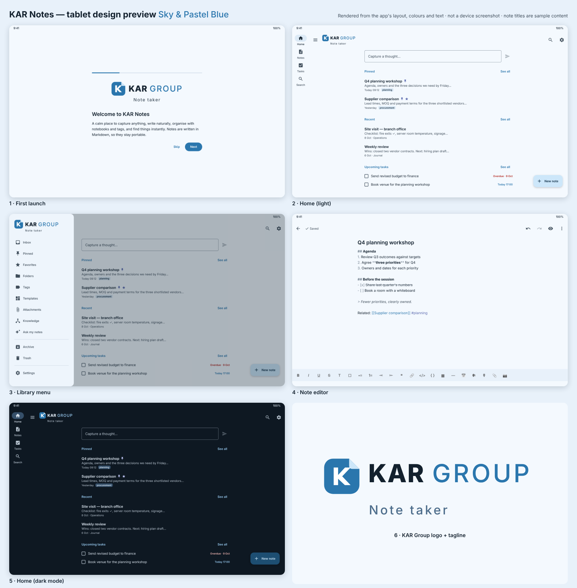

# KAR Notes — Note taker by KAR Group

A private note-taking app for Android tablets (it also adapts to phones and foldables). Kotlin, Jetpack Compose, Material 3, in a Sky & Pastel Blue theme with a **3D glossy** look (raised panels, glossy buttons and logo). A flat style can be chosen in Settings → Appearance.

**Read next:** [improvement review and roadmap](docs/IMPROVEMENT_REVIEW.md) · [feature coverage](docs/FEATURE_COVERAGE.md) · [design system](docs/DESIGN.md)

**All data is stored on the tablet.** There is no account, no online storage, no sync and no analytics. Optional AI can use your own OpenAI key; see [AI](#ai-and-the-hidden-openai-setup).



*The preview above is rendered from the app's layout, colours and text. Real emulator screenshots come from the GitHub build (see below).*

## Where your data lives

| What | Where | Leaves the tablet? |
|---|---|---|
| Notes, folders, tags, tasks, templates, history | Room/SQLite database in the app's private storage | No |
| Attachments (photos, PDFs, voice notes) | App-private `files/attachments` | No |
| Settings | DataStore in app-private storage | No |
| Backups | A file **you** save with the Android file picker (Downloads, SD card, USB drive). Home reminds you when there are 3+ notes and no backup in 14 days; the interval can be changed or switched off in Settings → Backup & data. | Only if you move it yourself |

How this is enforced:

- **No Android cloud backup or device transfer.** `allowBackup="false"`, and both `data_extraction_rules.xml` and `backup_rules.xml` exclude every data domain.
- **No sync, no account, no analytics, no crash reporting.**
- **The only network use is optional AI through your own OpenAI key.** When you run an AI action, the text that action needs is sent to OpenAI over HTTPS, and the answer comes back to the tablet. Examples: the note you're summarising, or the cited notes for "Ask my notes". Nothing is sent until a key is entered, and the app never stores your notes online. OpenAI's own data-retention terms apply to the requests it receives.
- **On-device OCR.** ML Kit uses the bundled model. As Google documents for ML Kit, it may send anonymous usage metrics to Google now that the app has internet access. It never sends your images or text.
- Sharing a note out (Share → another app) only ever happens when you tap it, and sends a copy of that one note.

## AI and the hidden OpenAI setup

AI is optional. Out of the box you can switch on the **on-device assistant** (Settings → AI), which needs no network. It summarises, extracts action items and dates, and suggests titles, tags and flashcards.

To connect **OpenAI**:

1. **Tap the KAR Group logo 10 times in a row**, with less than 1.5 seconds between taps. This works on the home screen's top bar, at the top of the library menu, or on the welcome screen. The tablet vibrates briefly and the **Connect OpenAI** window opens.
2. Paste your API key (it starts with `sk-`). You can change the model; the default is `gpt-5.4-mini`.
3. Tap **Save and turn on**.

The key is encrypted with the Android Keystore and never shown again. Once it's saved, OpenAI appears in Settings → AI, where you can change the model and let AI search across all your notes. Settings → Privacy shows "OpenAI connected", with a **Disconnect** button, and a log of how many requests have actually been sent to OpenAI and when the last one was. To replace or remove the key, tap the logo 10 times again. With OpenAI connected, every AI action (a note's ⋮ menu → AI assist) and "Ask my notes" use it, and answers cite the notes they came from.

The setup is hidden from screen readers too: the logo isn't announced as a button.


## Voice notes (speech-to-text)

- **Home → Voice note tile:** speak, and the words become a new note that opens in the editor.
- **Home → 🎤 in Quick capture:** your words go into the capture box, so you can check them before saving.
- **Editor → toolbar 🗣 button:** dictation is inserted at the cursor.

This uses Android's built-in speech recogniser. The app asks it to recognise speech **offline**, so audio stays on the tablet. To guarantee that, download the offline speech language in Android Settings → System → Languages → Speech (exact menu names vary by tablet). Without an offline language pack, the device's speech service may use its own online recognition.

## Drawing, pages, fonts and colours

- **Drawing canvas** (Home → Drawing, or the ✏️ Drawing button in a note's toolbar): pen, pencil, marker and highlighter (pressure from a stylus is recorded), an eraser that removes part of a stroke or whole strokes, shapes (line, arrow, rectangle, rounded box, ellipse, triangle, star) with optional fill, text boxes in any of the fonts, clipart and symbols. Pinch with two fingers to zoom and pan; the hand tool pans with one finger, and "Draw with stylus only" lets your palm rest on the screen.
- **Select, cut, copy, paste:** the lasso tool selects one item with a tap or several by drawing a loop. The selection bar has Cut, Copy, Paste, Duplicate, Change colour, Bring to front, Send to back and Delete; drag to move, drag the round handle to resize. Copied items can be pasted into another drawing. Unlimited-feeling undo/redo (100 steps).
- **Colours:** six pen-colour slots under the tools (long-press a slot to change it), a 32-colour palette, highlighter colours, recent colours, and a custom colour with hue, saturation, brightness, opacity or a hex code.
- **Page templates** (Home → New page): blank, ruled, narrow ruled, squared, dot grid, to-do list, Cornell notes, daily and weekly planner, meeting page, plus drawing pages (sketch, graph paper, music staff, storyboard). A note's paper can be changed any time from the toolbar's page button; text sits on the ruled lines.
- **Formatting shows as formatting:** bold text looks bold, italic looks italic, headings are bigger, and the `**`/`#` marks are hidden while you type (Settings → Appearance → "Show formatting marks while editing" brings them back). The toolbar buttons look like what they do (**B**, *I*, U̲, S̶) and the font list shows every font in its own typeface.
- **Fonts:** Sans, Serif, Mono plus bundled Caveat and Patrick Hand (handwriting), Dancing Script, Lora, Montserrat and Playfair Display (all SIL Open Font License, shipped in the app, no downloads). Choose a font for the whole note, or select text to change only that text.
- **Text colour and highlight** on selected text, and "clear colour, highlight and font".
- **Symbols** (Ω): arrows, maths, Greek, currency, shapes, ticks and crosses, faces, nature, music, with search. **Clipart:** about 100 vector pictures that stay sharp at any size and take any colour.

Drawings are stored on the tablet as attachments of their note (`.kardraw`, a small JSON file), are included in backups, and the text you type on a drawing is searchable.

## Import and export

- **Import** (Settings → Backup & data → Import files, or share a file to KAR Notes): Word `.docx` (headings, bold/italic/underline/strike, colours and highlights, lists, check boxes, tables, links, images), **PDF** (each page is read with on-device text recognition; the original PDF stays attached), RTF, CSV/TSV (becomes a table), Markdown, text, HTML and KAR Notes JSON exports. Nothing is uploaded to convert files.
- **Export a note** (note ⋮ → Share / export): Word `.docx` (with drawings as pictures), PDF (with a page per drawing), Markdown, web page (HTML) or plain text. Each can be saved to the tablet or shared to another app.
- **Export a drawing** (drawing ⋮): PNG image, SVG vector or PDF.

## Erase all data

Settings → Privacy (or the bottom of Backup & data) → **Erase all data**. You're asked to confirm three times:

1. A screen lists exactly what will be deleted, with a **Back up first** option.
2. Type **DELETE**.
3. If the app lock is on, unlock with your fingerprint or PIN.

The erase removes:
- notes, folders, tags, templates and version history;
- attachments;
- tasks and their scheduled reminders;
- the OpenAI key and AI request log;
- all settings, plus search and backup history;
- temporary files and notifications.

The app then restarts at the welcome screen. If any part fails, the app lists what couldn't be erased and offers **Try again**; it never reports a partial erase as complete. Backup files you saved outside the app are not touched.

## Put it on GitHub and get the APK

**Easiest (no command line): GitHub Desktop**

1. Sign in at github.com (create a free account if needed).
2. Unzip `kar-notes-project.zip`, which gives you a `kar-notes` folder.
3. Install **GitHub Desktop** (desktop.github.com) and sign in with your GitHub account.
4. In GitHub Desktop, choose **File → Add local repository…** and pick the `kar-notes` folder. When it says the folder isn't a repository, click **create a repository**, leave the defaults, then click **Create repository**.
5. Click **Publish repository**. Keep **"Keep this code private"** ticked, then click **Publish**.
6. On github.com, open the repository → **Actions** tab. The **Android build** workflow starts by itself (about 10 minutes for the APK and 20–30 for the tablet screenshots).
7. When it shows a green tick, open the run and scroll to **Artifacts**:
   - **kar-notes-debug-apk** is the installable app;
   - **tablet-screenshots** holds real screenshots from a tablet emulator.
8. To install, copy the `.apk` to the tablet, open it, and allow "Install unknown apps" for your file manager when asked.

If a step shows a red ✗, open it, copy the log, and send it to Claude to fix.

**Command line alternative** (from inside the `kar-notes` folder):
```bash
git init -b main && git add . && git commit -m "KAR Notes"
git remote add origin https://github.com/<your-account>/kar-notes.git
git push -u origin main
```
Don't use the website's "Upload files" button: it accepts at most 100 files at a time, and this project has about 290, including a hidden `.github` folder.

## Build locally (Android Studio)

Open the folder in Android Studio (Ladybug or newer), let Gradle sync, then run the **app** configuration on a tablet or emulator. You'll need JDK 17 and Android SDK 35; Android Studio installs the SDK for you.

```bash
./gradlew :core:domain:test          # product rules, search, templates, backup, AI policy (JVM)
./gradlew :app:assembleDebug         # debug APK → app/build/outputs/apk/debug/
./gradlew :app:lintDebug             # lint
./gradlew connectedDebugAndroidTest  # instrumented tests (needs a device/emulator)
./gradlew :app:assembleRelease       # release APK (needs your signing key, below)
```

**Release signing.** Create `keystore.properties` in the project root. It is git-ignored, so it never reaches GitHub. Fill in `storeFile`, `storePassword`, `keyAlias` and `keyPassword`. Alternatively, set the environment variables `MARGIN_KEYSTORE`, `MARGIN_KEYSTORE_PASSWORD`, `MARGIN_KEY_ALIAS` and `MARGIN_KEY_PASSWORD`. Never commit a keystore.

## Branding

| Item | File |
|---|---|
| Logo mark (vector, used in-app) | `app/src/main/res/drawable/kar_logo_mark.xml` |
| Logo + wordmark + tagline (in-app component) | `app/src/main/kotlin/app/margin/ui/components/Brand.kt` |
| Logo source artwork | `docs/brand/kar-group-mark.svg`, `docs/brand/kar-group-logo.svg` |
| Launcher icon | `res/drawable/ic_launcher_foreground.xml` on `@color/brand` |
| Colours | `ui/theme/Theme.kt` (app) and `res/values/colors.xml` (window, icon, widget) |
| App name and tagline | `tools/strings_source.py` (`app_name`, `brand_tagline`), then run `python3 tools/gen-strings.py` |

The logo and tagline appear on the first-launch screen, in the home screen's top bar and at the top of the library menu.

**Palette (Sky & Pastel Blue).** Sky blue `#2A76AD` is the primary colour, pastel blue `#CDE7FA` the containers, and sky mist `#F4F9FE` the background. Periwinkle `#5C6BB0` is used for pins and stars. Dark mode uses `#9DD0F7` on `#0E1822`. Every text and background pair meets WCAG AA contrast (4.5:1 or better). Wallpaper-based "dynamic colour" is off by default so the brand colours always show; it can be switched on in Settings → Appearance.

## Project layout

```
core/domain   Pure Kotlin: models, editor commands, autosave, search, templates (524 built-in),
              tasks/recurrence, import/export/backup, on-device assistant, security rules
core/data     Room database + FTS search index, repositories, DataStore settings, Keystore
app           Compose UI: home, notes, editor, search, folders/tags, templates, tasks/reminders,
              attachments/capture, knowledge, settings, backup/restore, app lock, widget
tools         Offline verification scripts (domain tests, SQL against SQLite, strings/resources)
```

Full feature-by-feature audit against the specification: **[docs/FEATURE_COVERAGE.md](docs/FEATURE_COVERAGE.md)**.

## Verification status

What has been verified so far:
- **Domain module:** compiles, and all 177 unit tests pass (`tools/verify-domain.sh`). This covers the drawing engine (lasso, eraser, cut/copy/paste, undo, page lines, file format, SVG), Word import/export round trips, RTF and CSV import, the hidden-formatting editor view, and page/font settings.
- **SQL:** all Room queries run against real SQLite (`tools/verify-sql.py`).
- **Resources:** every string and resource reference resolves (`tools/check-resources.py`).
- **Android build:** the app compiles and the debug APK is built by GitHub Actions on every push.
- **Tablet emulator:** the workflow installs the APK on a Pixel Tablet emulator, walks through the app (including the drawing canvas and page templates) and saves real screenshots to the `ci-logs-tablet` branch.

**Not yet verified:** handwriting feel, stylus pressure and palm rejection on a real tablet; PDF text recognition quality on your own documents; how exported Word files look in your version of Word. Try these on your tablet before relying on them.
